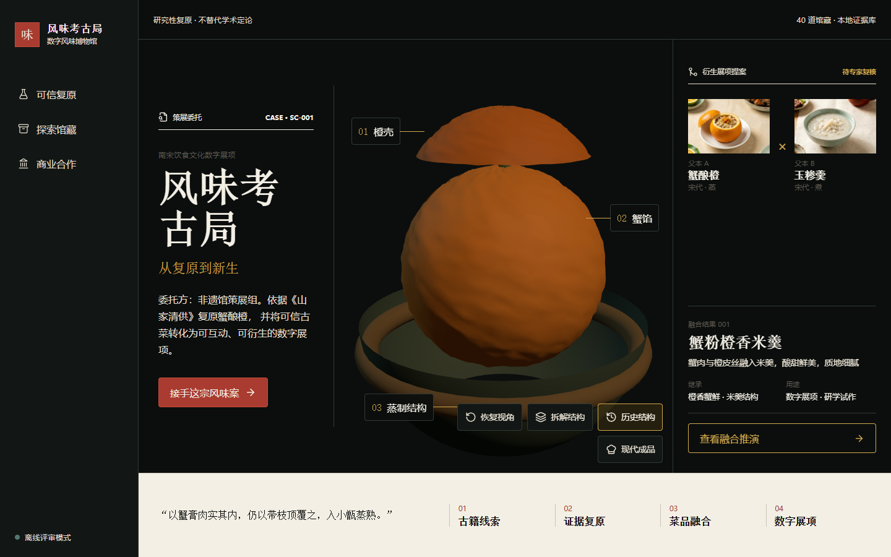
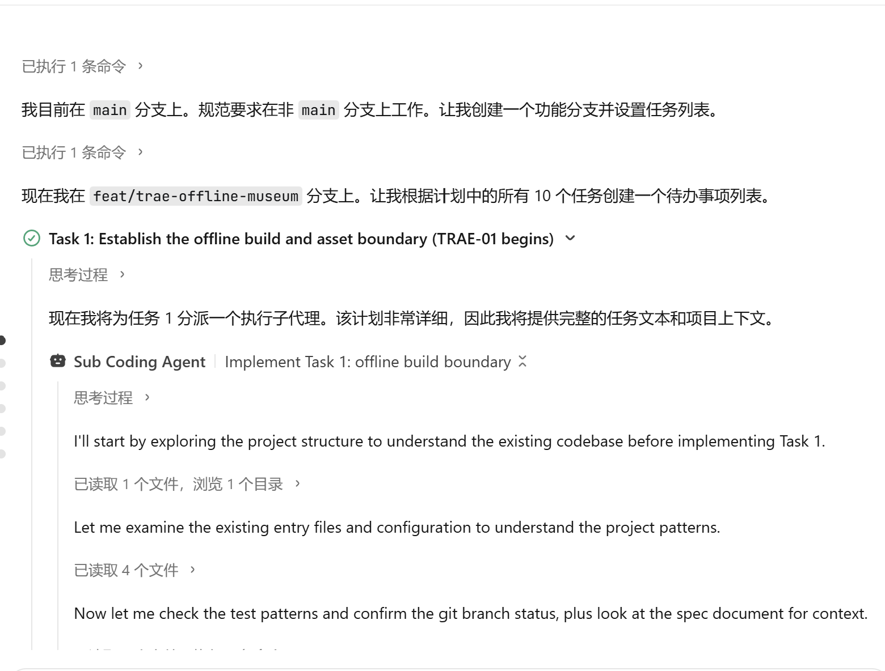
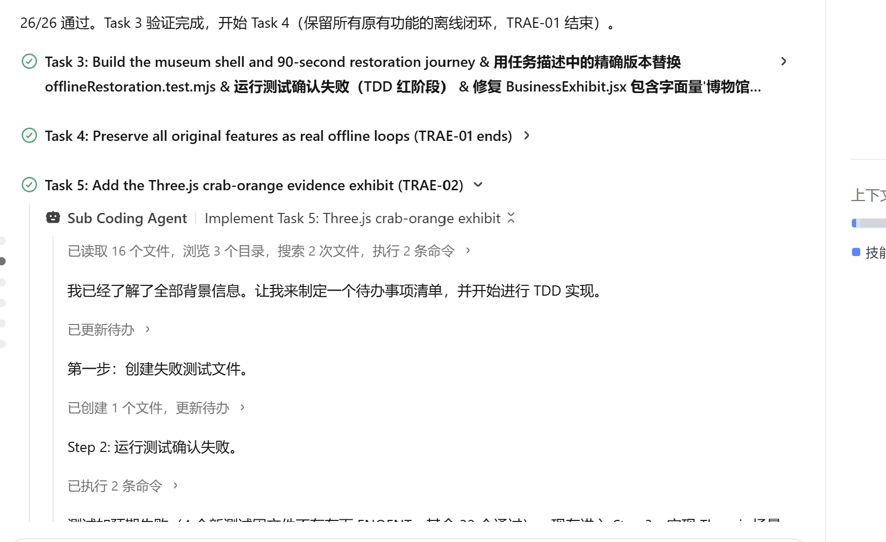
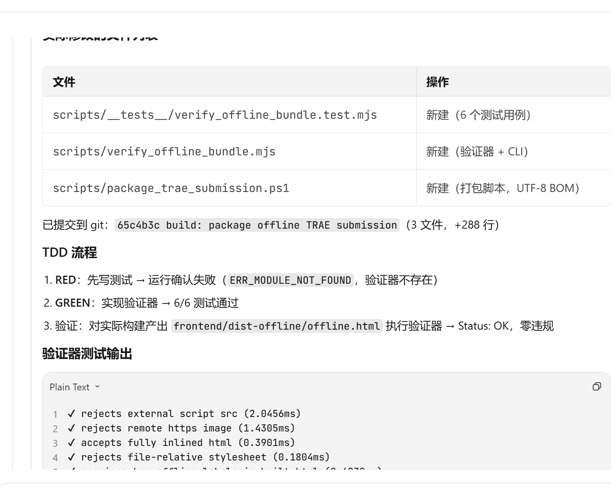

# 社会服务｜风味考古局：给我一行古书，还你一桌失传的盛宴

## 1. Demo 简介

风味考古局是一座可离线体验的数字风味博物馆：首页以“策展委托”呈现非遗馆的真实任务，把古籍线索、证据复原、菜品融合与数字展项编排为一条可审阅的交付链。

第一目标用户是博物馆、非遗馆的策展与教育部门——他们需要把分散的饮食文献转化为可参与、可说明来源的展项。

它不止把一道古菜复原回来，还把可信馆藏变成可继续生长的文化资产：策展人可选择两道有历史档案的父本，通过离线规则推演查看继承技法、现代转译、风险与待复核项。例如“蟹酿橙 × 玉糁羹”会形成“蟹粉橙香米羹”展项提案，串起“古籍线索 → 证据复原 → 菜品融合 → 数字展项”的完整闭环。

四项核心能力：

- **可信复原**：90 秒主流程，从一段古书描述到给出文献、食材、技法、时代地域约束与现代转译的同一条可见证据链。
- **3D 证据展台**：基于 Three.js 程序化生成的蟹酿橙证据展台，三个证据热点（壳、馅、蒸制）各自携带完整引文，支持线框到材质过渡与结构拆解。
- **数字馆藏**：40 道风味档案（`dish_001..dish_040`），每道携带图片、名称、朝代与证据字段，全部内嵌、无需联网。
- **可衍生展项**：蟹酿橙与玉糁羹经本地规则引擎形成“蟹粉橙香米羹”提案，并原子地带入预选父本的研究界面。

## 2. Demo 创作思路

**真实痛点**：非遗饮食资料分散在古籍、地方志与口述记录中，难以被普通使用者触达；传统展陈以图文为主，缺少参与感；普通生成式 AI 能给出菜谱，却难以说明来源、无法把约束条件纳入同一条可追溯链路。

**为什么选择"证据化复原"而不是普通菜谱生成**：我们把文献、食材、技法、时代地域约束和现代转译放进同一条可见证据链。复原结果不是凭空生成的文本，而是一条可被读者逐项核对的证据——每一个结论都标注来源、每一道菜都暴露证据种类与必需标签。这样博物馆策展人才能把展项交给观众检验，而不是让展项沦为不可追溯的生成内容。

**为什么以博物馆互动展项作为第一落地场景**：文博互动展陈是首要落地场景——它同时要求"可参与"与"可说明来源"，正好对应证据化复原的两项核心要求。研学课程是第二阶段，可以在博物馆展项跑通后再向教育场景延伸。

## 3. Demo 体验方式

- 最终提交包：`release/风味考古局-TRAE初赛.zip`（1,066,335 字节）；主 HTML 为 2,058,152 字节，低于 3MB 限制。
- 解压后双击主 HTML，无需联网——离线评审模式，所有数据内嵌。
- 推荐使用 Chrome 或 Edge 桌面版获得最佳体验。
- 所有资源以 `data:` URI 或内联方式提供，无任何外部脚本、样式表、图片或网络请求。

## 4. TRAE 实践过程

整体计划按三个 TRAE 任务拆分。三个真实 Session ID 与对应的开发过程截图已归档；当前仅等待审核通过的报名帖链接，链接未提供前不宣称参赛材料已正式提交。

| 任务 | Session ID | 执行日期 | 已归档证据 |
| --- | --- | --- | --- |
| TRAE-01 离线数字博物馆 | `6a55f8c1fd3185fa87ee5d3a` | 2026-07-14 | `trae-01-progress.png` |
| TRAE-02 Three.js 展台 | `6a562c2ffd3185fa87ee63f0` | 2026-07-14 至 2026-07-15 | `trae-02-progress.png` |
| TRAE-03 验证与提交 | `6a56f39ca1f7f092c0593b3d` | 2026-07-15 | `trae-03-verification.png` |

### TRAE-01 离线数字博物馆与功能闭环

**关键实现**：

- 独立离线入口（非路由器入口，使用有限展厅键集合代替路由）。
- 单文件构建（Vite `vite-plugin-singlefile`），所有 JS/CSS 内联进一个 HTML。
- 40 道风味档案，ID 遵循 `dish_001..dish_040` 零填充格式。
- 确定性线索匹配（`matchClue` 对规范段落返回 matched，对弱线索返回 insufficient 并列出至少三个需要的线索）。
- 90 秒主线复原旅程，五个命名阶段。
- 所有原有功能离线闭环：数字传承人、味觉星图、风味进化、拍照认祖、每日复活、真假非遗、分享证书。

**取舍**：不破坏现有在线应用，使用有限展厅键集合代替路由，使离线体验与在线应用互不干扰。

**测试**：先失败后通过，61 项离线专项测试覆盖数据、规则、shell、复原旅程、3D 与功能闭环。

**Session ID**：`6a55f8c1fd3185fa87ee5d3a`

### TRAE-02 Three.js 蟹酿橙证据展台

**关键实现**：

- 程序化几何：碗、壳、馅、盖全部由代码生成，不加载任何外部模型文件。
- 三个证据热点（壳、馅、蒸制），各自携带完整引用字段。
- 线框到材质过渡、结构拆解（爆炸视图）、重置控制。
- 2.5D 降级：WebGL 不可用时自动回退到 `CrabOrangeFallback` 静态组件，不影响其他展品。

**取舍**：不加载 GLB/GLTF，全部程序化生成——保证离线包零外部模型依赖，构建产物经正则搜索 `\.glb|\.gltf` 无任何匹配。

**测试**：7 个 3D 契约与降级测试，覆盖 WebGLRenderer、球体几何、轨道控制、重置/拆解、历史/现代模式、三热点引文、资源清理、WebGL 回退和首页变体透传；离线专项共 61 项通过。

**Session ID**：`6a562c2ffd3185fa87ee63f0`

### TRAE-03 离线验证、提交包与参赛材料

**关键实现**：

- 包验证器（`verify_offline_bundle.mjs`）：检测外部脚本、远程图片、内联 HTML、外部样式表、必需标签缺失、CSS `url()` 外部引用与 `fetch()` 调用。
- 打包脚本：生成最终 ZIP 与中文空格路径验证副本。
- 证据门禁（`verify_trae_submission.mjs`）：校验离线 HTML、ZIP、参赛帖草稿、报名帖链接格式、三个 Session ID 非空且互不相同、三个任务各至少一张截图存在。
- 验证报告（`docs/competition/verification-report.md`）：记录发布产物、自动化门禁、浏览器验收及 TRAE 证据归档状态。

**取舍**：对已取得的 Session ID 和开发截图按原始任务归档；对尚未取得的报名帖链接保持诚实待补状态，不使用任何虚构链接替代。门禁会如实报告该缺失。

**测试**：36 个脚本测试通过；证据门禁已验证三个任务的 Session ID 与截图，当前仅因报名帖链接缺失而报告 `NOT READY`。

**Session ID**：`6a56f39ca1f7f092c0593b3d`

### 最终验证结果

- **离线测试**：61 项通过（覆盖 40 道馆藏、五阶段复原、研究工具、3D 场景、2.5D 降级、干净检出资源生成与离线构建契约）。
- **脚本测试**：36 项通过（覆盖资产预算、知识图谱校验、关系覆盖统计、离线包验证器、Canvas 变化检测和不可绕过的提交清单门禁）。
- **中文空格路径验证**：通过（验证器能正确读取 `tmp\中文 空格 验证\风味考古局-离线体验.html`）。
- **外部资源引用**：0 违规（外部脚本、样式表、图片、CSS `url()`、`fetch()` 调用均为 0）。
- **必需标签**：6/6 全部存在（离线评审模式、接手这宗风味案、查看融合推演、探索馆藏、互动研究、商业合作）。
- **真实浏览器验收**：Edge 147 与 Chrome 150 的 1440x900、1280x720、390x844 视口，以及相同三个视口的 WebGL 强制降级场景，共 12 个场景全部通过。
- **TRAE 开发证据**：三个真实 Session ID 互不相同，且每个任务均已关联一张可识别的开发过程截图；证据清单见 `docs/competition/trae-evidence-manifest.json`。

## 5. 报名帖链接

【待补：审核通过的报名帖链接】
