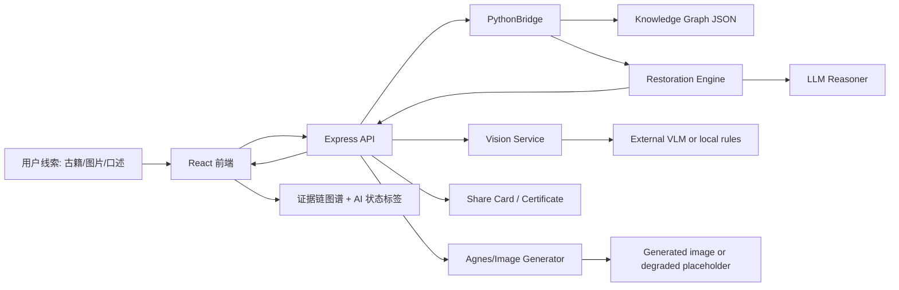

# 技术架构

## 总览

风味考古局由三层组成:

- React/Vite 前端: 负责输入、复原结果、证据图谱、味觉星图、轻量玩法和数字传承人。
- Express 后端: 负责 API 编排、认证、分享证书、视觉识别、图片生成和 Node 到 Python 桥接。
- Python 服务: 负责知识图谱读取、古籍线索分析、菜品复原、风味进化和 LLM 推理 fallback。



## 核心 workflow

1. 线索接收  
前端提交古籍片段、图片描述或口述线索。评委模式会自动装入蟹酿橙样例，保证 90 秒路径稳定。

2. 知识图谱检索  
Python `RestorationEngine` 从菜品、食材、技法、朝代、地域和古籍节点中抽取候选证据。

3. LLM 增强推理  
配置 `OPENAI_API_KEY`、`OPENAI_BASE_URL` 和 `MODEL_NAME` 后，系统调用 OpenAI-compatible chat completion。未配置时回到关键词和图谱规则。

4. 证据门槛  
弱线索不会默认复原第一道菜。系统返回 `evidenceStatus: insufficient` 和 `needsMoreClues: true`。

5. 图片生成  
配置 `AGNES_API_KEY` 后调用 Agnes 图片模型。失败或未配置时返回 `status: degraded`、`fallbackReason` 和 placeholder。

6. 前端呈现  
Result 页展示 AI 状态标签，包括真实 AI、降级、缓存演示和本地规则。

## 可观测字段

AI 相关响应逐步统一到:

```json
{
  "provider": "agnes",
  "model": "agnes-image-2.0-flash",
  "latencyMs": 242,
  "mode": "generated",
  "fallbackReason": null,
  "configured": true
}
```

这些字段用于路演解释: 系统什么时候用了真实模型，什么时候用了本地规则，什么时候只是为了演示稳定性使用缓存。

## 图谱覆盖率与下一步护城河

新增 `scripts/verify_knowledge_graph_coverage.mjs` 作为知识图谱可观测性检查入口。脚本直接读取 `data/knowledge_graph/nodes_dish.json` 和 `data/knowledge_graph/relationships.json`，自适应识别关系端点与关系类型字段，并按 `recorded_in`、`contains`、`uses_technique`、`originated_in` 四类核心关系输出 JSON 摘要和 Markdown 审计表。

当前审计结果显示: 40 个菜品中，10 个至少具备 1 类核心关系，30 个没有任何核心关系；`recorded_in` 覆盖 9/40，`contains` 覆盖 7/40，`uses_technique` 覆盖 6/40，`originated_in` 覆盖 10/40。这个指标把“菜品数量”从展示口径推进为“可审计关系密度”口径，避免技术护城河只停留在静态内容库。

下一步护城河建设优先补齐关系闭环: 48 小时内先让每道菜至少拥有 1 条核心关系，复赛阶段推动每道菜达到至少 3 类核心关系，融资阶段为关键关系补充来源 URL、证据等级、人工校验人和校验日期。
## Graph schema validation gate

`scripts/verify_graph_schema.mjs` complements the coverage audit. The coverage audit answers "how much of the graph is connected"; the schema gate answers "can these graph claims be trusted enough to present." It checks real JSON data for valid relationship endpoints, schema-known relationship types, type-compatible source/target nodes, source metadata on `recorded_in` edges and dish nodes, and a lightweight expert-review manifest for flagship nodes/citations.

The manifest lives at `data/knowledge_graph/expert_review_manifest.json`. Current statuses are deliberately conservative (`internal_reviewed` and `pending_external_expert`) so the architecture can show an audit trail without overstating external expert approval.
